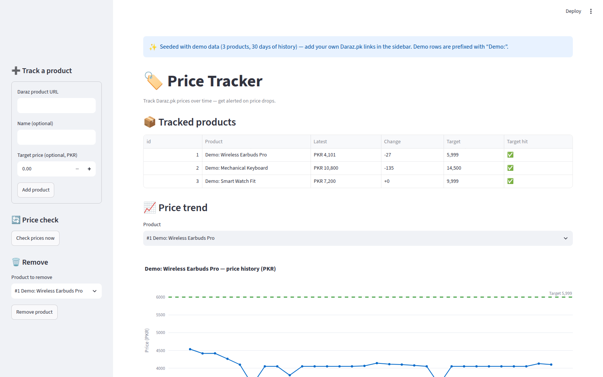
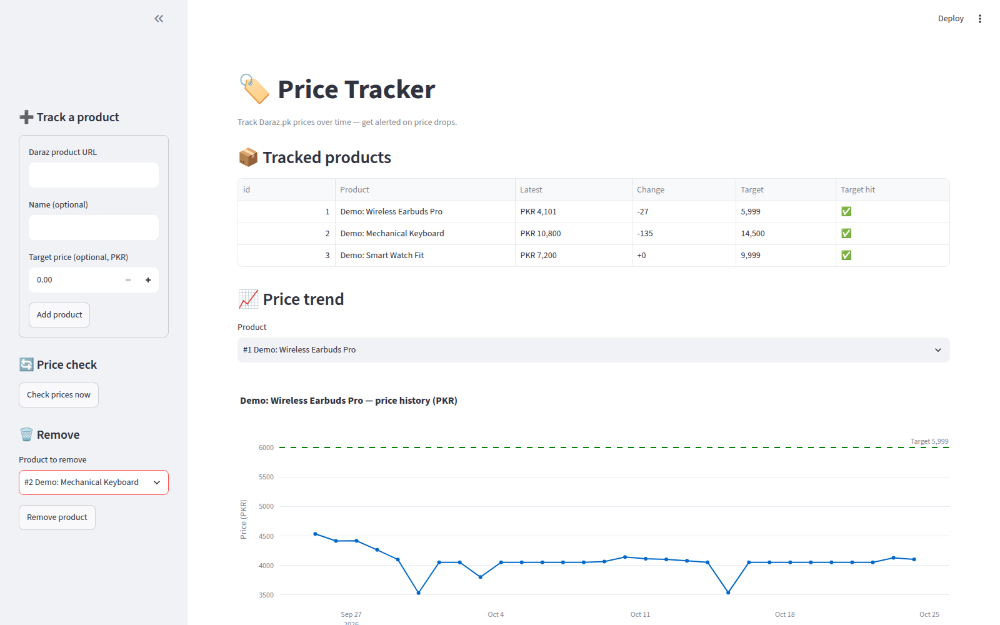
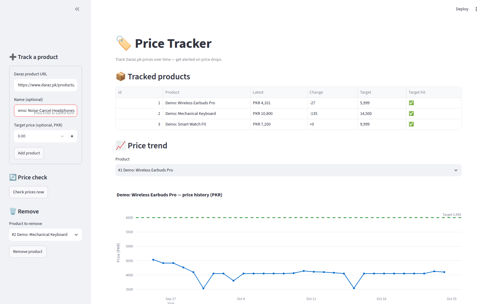

# 🏷️ Price Tracker

[](https://www.python.org/)
[](https://streamlit.io/)
[](https://github.com/Saghar-Siddique/Price-Tracker/actions/workflows/ci.yml)
[](https://github.com/Saghar-Siddique/Price-Tracker/actions/workflows/ci.yml)
[](LICENSE)

**Never overpay again.** Track product prices across Pakistani stores over
time — add a product link, and Price Tracker scrapes the current price on
demand, stores every check in SQLite, charts the trend, and alerts you on
price drops or when your target price is hit.

🔗 **Live Demo:** [price-tracker-saghar.streamlit.app](https://price-tracker-saghar.streamlit.app/)

**Perfect for:** bargain hunters, resellers tracking competitor prices, and
anyone who wants to buy at the right moment.

## Features

- 🕷️ **Multi-store scrapers** — Daraz.pk (exact selling prices via headless Chromium/Playwright: promotion/discount prices when a sale is active, regular price otherwise), PriceOye.pk and Telemart.pk (static HTML, verified live)
- 🧩 **Plugin system** — every store is one `BaseScraper` class; adding a store needs no CLI/dashboard changes (see below)
- 🗄️ **Price history in SQLite** — every check timestamped, queryable, yours
- 📊 **Streamlit dashboard** — product table, Plotly trend charts with target-price line, alerts panel
- 🔔 **Smart alerts** — price-drop % vs last check, plus target-price hits
- 🖥️ **Full CLI** — add / list / remove / check / history / report
- 🧪 **Tested** — 47 pytest tests with fixture-based scraper tests (no network in tests); CI runs the suite on every push and PR

## Supported stores

| Store | What it tracks | How the price is read |
|---|---|---|
| Daraz.pk | Any product page | Headless Chromium (exact selling price, incl. promotions); static HTML fallback |
| PriceOye.pk | Mobiles | schema.org JSON-LD Product block (verified live) |
| Telemart.pk / TeleX | Any product page | Sale-price block (`product-price__sale`); embedded variant JSON fallback |

Unknown shops fall back to a generic schema.org JSON-LD extractor.

### Adding a new store

One class, nothing else — the CLI, dashboard, and tracker never change:

```python
from price_tracker.scraper import BaseScraper, register_scraper

@register_scraper
class MyStoreScraper(BaseScraper):
    name = "MyStore"
    domains = ("mystore.pk",)

    @staticmethod
    def extract(html: str) -> tuple[str, float, str]:
        # parse (name, price, currency) from the product page HTML
        ...
```

If the shop renders prices client-side, override `fetch()` instead (see
`DarazScraper`). Add a fixture + tests in `tests/test_stores.py` and the
store works end-to-end through `check_all` immediately.

## Screenshots





## Quickstart

```bash
pip install -r requirements.txt
playwright install chromium   # one-time: downloads the headless browser

# Track a product (optional target price in PKR)
python -m price_tracker.cli add "https://www.daraz.pk/products/<slug>.html" --target 45000

# Check current prices (alerts on drops / target hits)
python -m price_tracker.cli check

# Launch the dashboard
streamlit run dashboard_app.py
```

The dashboard seeds itself with demo data on first run, so you can explore
every chart offline before adding real products.

## CLI usage

```bash
python -m price_tracker.cli add <url> [--name NAME] [--target PRICE]
python -m price_tracker.cli list
python -m price_tracker.cli remove <id>
python -m price_tracker.cli check          # scrape all, store, print alerts
python -m price_tracker.cli history <id> [--limit 50]
python -m price_tracker.cli report         # latest prices, changes, targets
```

The database defaults to `./prices.db` — override with `--db PATH` or the
`PRICE_TRACKER_DB` environment variable (the dashboard respects it too).

Sample products to try: [`data/sample_products.csv`](data/sample_products.csv).

## How the Daraz scraper works

Daraz renders its prices client-side: the static HTML only ever contains the
original list price — promotion/sale prices (like a Rs. 234 flash deal on a
Rs. 1,000 item) are fetched by JavaScript after the page loads. So for
daraz.pk, Price Tracker renders each product page in headless Chromium
(Playwright) and reads the exact price a shopper sees: the promotion price
when a discount is active, otherwise the regular price. The rendered
price is picked by three strategies, in order: the standard
``pdp-price_type_normal`` element, the first non-deleted ``pdp-price``
element, and — when Daraz renames its price classes — the smallest Rs.
amount inside the price box (a sale price is always ≤ the original
price; per-month installment amounts are excluded). The browser waits
for the price element itself (up to 30s), not just the title, because
Daraz renders the price after the title — it also waits for the
network to settle first (best-effort, capped at 15s), and if the page
loads but no price appears it reloads once and tries again: lazily
rendered prices often appear on a second load. If no price ever
appears, the failure message carries a snippet of the page text, so
the dashboard warning shows whether the page was a bot check or just
an empty price box. A check can therefore take a few minutes when
Daraz is slow — the dashboard spinner says so while it runs. If no
browser can be launched, it falls back to static HTML extraction
(`pdpTrackingData`
embedded JSON, verified live on daraz.pk) with schema.org JSON-LD and
visible price text as further fallbacks — **but the static fallback
returns the list price on a sale page, not the sale price** (verified
live Nov 19, 2026: a Rs. 699 sale was recorded as Rs. 2,199 while no
browser was available). That fallback is never silent anymore: every
check reports per product whether its price came from the rendered
page, and the dashboard (and CLI) show a warning for any product whose
price came from static HTML. The launcher first tries Playwright's
bundled Chromium, then a system Chromium (`PLAYWRIGHT_CHROMIUM_PATH`,
else `/usr/bin/chromium` and friends) with container flags
(`--no-sandbox --disable-dev-shm-usage --disable-gpu`). Polite by default:
browser User-Agent, 10s timeout, one retry, 1s delay between products.

### Deploy on Streamlit Cloud

`packages.txt` installs Debian's `chromium` at deploy time so the rendered
price path works on Streamlit Cloud (the `playwright` pip package alone does
not ship a browser binary). Without it, Daraz checks silently fall back to
static HTML and record list prices on sale pages.

## Project structure

```
price_tracker/
  models.py      # Product / PricePoint dataclasses
  database.py    # SQLite schema + CRUD
  scraper.py     # BaseScraper plugins (Daraz, PriceOye, Telemart, generic) + registry + polite fetching
  tracker.py     # check_all(): scrape → store → alerts
  alerts.py      # Alert model + formatting
  cli.py         # argparse interface
dashboard_app.py # Streamlit dashboard (Plotly charts, seeded demo data)
tests/
  fixtures/daraz_product.html  # realistic Daraz fixture (no network in tests)
  fixtures/daraz_sale_product.html  # trimmed real sale page (sale Rs. 699 / list Rs. 2,199)
  fixtures/priceoye_product.html  # trimmed live PriceOye page
  fixtures/telemart_product.html  # trimmed live TeleX page
  test_scraper.py / test_stores.py / test_database.py / test_tracker.py / test_dashboard.py
data/sample_products.csv       # 3 real Daraz URLs to try
```

## Disclaimer

This tool is for personal, educational use. Scraping may be subject to a
site's Terms of Service — keep check frequency gentle (the built-in 1s
delay helps), respect `robots.txt`, and stop if a site asks you to.

## License

MIT — do whatever you want with it.
